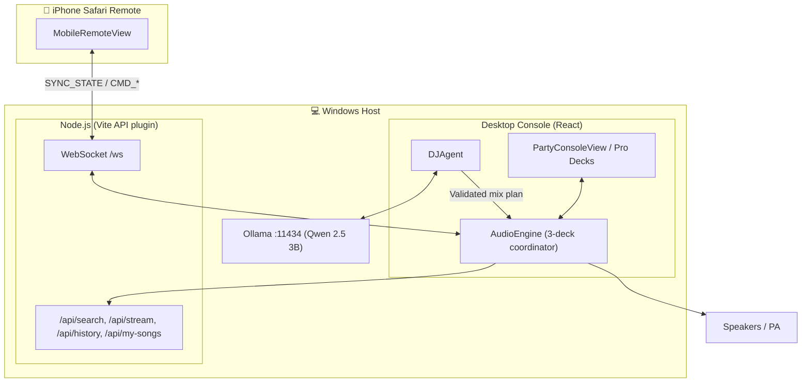

# AI DJ — Architecture & Engine Specification

This is the single technical reference for how AI DJ is built: system topology, the audio engine, BPM detection, the Live Rhythm Enhancer (Deck P), transitions, auto-curation, viral-hook detection, the UI, and the mobile WebSocket protocol.

For requirements see [`context.md`](context.md). For musical behaviour rules see [`DJ_KNOWLEDGE_AND_MIXING_RULES.md`](DJ_KNOWLEDGE_AND_MIXING_RULES.md). For hardware, network setup and licenses see [`SETUP_AND_OPERATIONS.md`](SETUP_AND_OPERATIONS.md).

---

## 1. Core Invariants

1. **Audio Thread Invariant:** Real-time audio (Deck A, Deck B, Deck P) must never stutter or be blocked by AI inference, downloads, UI rendering, or analysis.
2. **Host Authority Principle:** The Windows laptop is the sole source of truth. The iPhone is only a control surface. Audio never goes through the phone, and a sleeping or disconnected phone never stops the music.
3. **Anti-Clash Rule:** Live percussion is muted or held if beat confidence is below 60% or the track is an acoustic/slow ballad. Silence beats out-of-sync drums.
4. **LLM as planner, not processor:** The LLM emits structured plans that are validated with Zod. The audio engine executes them deterministically.

---

## 2. Technology Stack

| Layer | Technology |
| :--- | :--- |
| UI | React 19, TypeScript, Vite, Tailwind CSS v4 |
| Desktop shell | Browser via Vite dev server today; Electron packaging planned |
| Audio engine | Web Audio API (native nodes, `AudioParam` automation) |
| Analysis | In-browser TypeScript DSP (`BpmDetector`, `HighlightDetector`); Python/Librosa MIR is a future option |
| Local AI | Ollama + Qwen 2.5 3B (CPU mode), Zod schema validation, heuristic fallback |
| Backend | Vite plugin (`server/apiPlugin.ts`): REST + `ws` WebSocket server |
| Acquisition | `yt-search` (metadata), `@distube/ytdl-core` (audio stream) |
| Storage | Local files + JSON (`data/play_history.json`, `my_songs.txt`) + in-memory state. SQLite only if needed later (see [storage policy](SETUP_AND_OPERATIONS.md#5-storage-policy)) |

---

## 3. System Topology



**Request flow:** mobile request → validated command → track acquisition → decode + analysis → ready queue → transition planner → audio engine → speakers. Deck P keeps running through the whole flow.

---

## 4. Audio Engine & Three-Deck Topology

- **Deck A**: outgoing/master track. **Deck B**: incoming track, tempo-matched and phase-aligned.
- **Deck P**: the Live Rhythm Enhancer. Real percussion samples scheduled hit by hit on the on-air song's beat grid (§6).

```
  Deck A Source          Deck B Source          Deck P (scheduled hits)
       │                      │                      │
  Low shelf 250 Hz       Low shelf 250 Hz       Highpass 50 Hz (Q 0.707)
  Peak mid 1 kHz (Q1)    Peak mid 1 kHz (Q1)    Presence peak 3 kHz +2.5 dB
  High shelf 3.5 kHz     High shelf 3.5 kHz     Percussion gain + ducking
  Deck A gain (xfade L)  Deck B gain (xfade R)       │
       └──────────────┬───────┴──────────────────────┘
                 Master mix bus → Limiter (knee −1 dBFS) → Destination
```

**3-band isolator EQ:** each band ranges from −40 dB to +6 dB. At −40 dB the band is effectively silenced (a full kill).

---

## 5. BPM & Downbeat Detection (`src/audio/BpmDetector.ts`)

```
PCM → one-pole lowpass (150 Hz) → 5 ms RMS envelope → onset strength (rise in log energy)
    → autocorrelation over 70–180 BPM periods (× tempo prior) → bar-peak refinement → BPM
    → onset histogram over one beat → beat-grid phase
```

The analysis covers up to 60 s, starting 20 s in.

1. **Low-pass + envelope:** isolates kicks and dhol strikes. The envelope uses 5 ms hops.
2. **Onset strength:** half-wave rectified rise in $\log(1 + 100\,E/E_{max})$, lightly smoothed (~15 ms) so beat periods that fall between frames still correlate.
3. **Tempo:** the beat period maximises $(\text{AC}[\ell] + 0.5\,\text{AC}[2\ell]) \cdot \text{prior}(\text{BPM})$. The prior is log-normal around 120 BPM (σ = 0.9 octave) and resolves half/double-time ambiguity. The period is then refined by parabolic interpolation on the **4-beat (bar) peak**, giving about 0.01 BPM precision. BPM is returned with two decimals.
4. **Confidence:** $\text{AC}[\text{period}] / \text{AC}[0]$, scaled so a value ≥ 0.3 maps to 1.0. Random hits and noise score about 0.1–0.2.
5. **Beat phase** (`firstDownbeatTime`): onset strength is folded into a one-beat histogram, and the interpolated peak gives the phase. Using the peak rather than a mean makes it robust to off-beat hits.

On synthetic tests (kick-only and full patterns, 87–140 BPM), BPM came out within 0.01 and phase within 6 ms. 170 BPM is reported as 85 (half-time), which the mixer handles.

**Limitation:** this finds beats, not which beat is "1" of the bar.

---

## 6. Live Rhythm Enhancer (Deck P)

Real dhol, dholak and percussion samples on top of the song on air (`src/audio/rhythm/`). The rules it follows are in [MIXING_RULES.md](MIXING_RULES.md#live-rhythm-enhancer-deck-p); this section is how it's built.

| File | Role |
| :--- | :--- |
| `kit.ts` | The sample kit: voices (dhol bass/crack, dholak ge/na, tambourine, shaker…), their takes in `public/percussion/` (CC0, see `CREDITS.md`), level trims, low cuts and pan |
| `styles.ts` | 8 styles as 16-step bars with light / full / fill versions and swing |
| `rhythmPlan.ts` | Per-song decision: language (known artist/script → AI `identifySong` → guess), audio features (punch, vocal share, contrast), and `planRhythm` → play / style / level / reason |
| `arrangement.ts` | Pure: per bar, rest / light / full / fill from the song's `EnergyProfile` in 4-bar phrases |
| `RhythmEnhancer.ts` | The scheduler, the per-voice chains and the controls (`RhythmCommand`) |

**Scheduling.** A 25 ms timer schedules every hit that falls in the next 0.2 s with `AudioBufferSourceNode.start(when)`. `when` comes from the on-air song's beat grid through `AudioEngine.rhythmClock()`:

$$t_{	ext{ctx}} = t_{	ext{start}} + rac{t_{	ext{downbeat}} + 	ext{bar} cdot L_{	ext{bar}} + 	ext{swing}(s) cdot L_{	ext{beat}}}{	ext{rate}}$$

where $t_{	ext{start}}$ and rate come from `VirtualDeck.getClockAnchor()` (position = (now − start) × rate) and the lengths are in song seconds at the track's own BPM (doubled above 140 BPM for half-time). There is no loop buffer, so there is nothing to drift, tempo changes don't affect pitch, and a tempo change is picked up within one 0.2 s look-ahead. A new song, a re-timed song (key-lock tempo) or a seek re-locks onto the first step at or after now; `silence()` stops hits already scheduled (pause, seek, stop).

**Signal chain.** hit → velocity gain → per-voice high-pass + panner → level bus → glue compressor (−20 dB, 3:1) → 0.8 → master bus (so the master EQ and limiter apply).

**Mixes.** `rhythmClock()` reports a transition as `blend` (beatmatched: light groove, no fills) or `cut` (rest). The clock follows `activeDeck`, so the layer moves to the new song's grid when the crossfader passes the middle.

**Holding.** Below 50 % beat confidence, or outside 70–200 BPM, it schedules nothing and reports why.

**Per-song plans.** `AudioEngine.ensureRhythmPlan()` runs after every track analysis and on every tick for the song on air (memoised by song, mood and language). It builds the plan at once from the best language it has and queues unknown songs for `DJAgent.identifySong()`: one question at a time, waiting while a mix or next-song question is in flight, with the answer constrained by a JSON schema (`/api/llm` passes `schema` to Ollama's `format`, at temperature 0). Answers are stored in `localStorage` (`ai_dj_song_languages`). The plan reaches the scheduler through `SongClock.plan`. Rules and test results: [MIXING_RULES.md](MIXING_RULES.md#5-who-decides-what-plays-on-each-song).

The old design (a procedurally synthesised 4-bar loop sped up or slowed down with `playbackRate`, plus an LLM call that chose a pattern and volume) was replaced because it changed pitch with tempo, could drift between re-syncs, and sounded synthetic.

---

## 7. Phrase-Aware Transitions

```
Bars:          1          2          3          4          5
Deck A gain:  1.00 ────> 0.70 ────> 0.30 ────> 0.00
Deck A bass:  0 dB ────> 0 dB ────> −40 dB ──> −40 dB
Deck B gain:  0.00 ────> 0.30 ────> 0.70 ────> 1.00
Deck B bass: −40 dB ───> −40 dB ──> 0 dB ────> 0 dB
Deck P:       light groove (blend) / rest (cut) ───────> follows Deck B's grid
```

1. **Analysis first:** every track's BPM, confidence, downbeat and hook are detected once, when it is preloaded or acquired. This happens whether or not the rhythm layer is on.
2. **Pitch-safe tempo matching:** deck tempo is changed through `playbackRate`, which also shifts pitch because there is no key lock (5.95% = 1 semitone; sudden jumps are noticeable from about 2–3%). So:
   - **Pre-mix tempo ramp:** in the 20 s before an auto-mix (42 → 22 s from the end), the *outgoing* song glides at 0.4%/s toward the next song's tempo. It moves by up to 8%, and a gradual ramp is much less noticeable than a jump.
   - **Incoming match:** the incoming rate is $\text{BPM}_{A,\text{eff}} / (\text{BPM}_B \times m)$, with $m \in \{0.5, 1, 2\}$ chosen to give the smallest change. It is applied only if both confidences are ≥ 0.6 and the remaining shift is ≤ 4%.
   - Together these beatmatch tempo gaps of up to about 12%. Larger gaps get a **2 s cut on the beat** at natural pitch, with no long flam.
   - The rate is set before the incoming deck starts.
3. **On the one:** the incoming deck is *scheduled* (`AudioBufferSourceNode.start(when, offset)`) so its first beat lands exactly on the outgoing song's next beat. Its cue point is on its own beat grid: the hook cue is snapped to that grid, and a start from the beginning uses the first beat.
4. **Blend length:** 8 bars at the outgoing tempo, clamped to 8–20 s, unless a caller (Pro mixer, AI command) specifies a length.
5. **Pitch return:** after the mix, an engine-set rate glides back to 1.0 at 0.4% per second. Manual pitch fader settings are never touched.
6. **Bass swap:** the outgoing low band ramps to −24 dB over the first half. The incoming low band ramps from −24 dB to 0 dB over the second half.
7. **Audio-clock scheduling:** the crossfade (equal-power curve) and the EQ ramps are scheduled as `AudioParam` automation starting at the beat-aligned start time. Mixes therefore finish correctly even when the browser tab is hidden. Moving the crossfader by hand cancels an automatic mix.
8. **Outro auto-trigger:** when ≤ 22 s remain on songs longer than 60 s, and a queued track is **ready**, the transition fires. If nothing is ready, the current song keeps playing. **Next** does nothing except show a status message, and a song is never swapped in mid-mix.
9. **Drums follow the on-air deck:** Deck P reads its clock from the on-air deck, so once the crossfader passes the middle it plays on the new song's beat grid.

### 7.3 Party tempo lock with key lock (`TimeStretch.ts`, `timeStretch.worker.ts`)

In the Party mood, the whole set is locked to one **session tempo** in the 120–130 BPM dance range. The research behind that range: people's natural movement tempo is just above 120 BPM (~2 Hz), and dance music clusters at 125–130 BPM.

- **Choosing the tempo:** it's the on-air song's tempo if that is already in range (half/double time counts), otherwise 124 BPM.
- **Tuning each song:** every ready song is time-stretched to the session tempo with **WSOLA** (Waveform-Similarity Overlap-Add). Grains of 46 ms are overlap-added at 50% with a Hann window, and each grain is nudged by up to ±11.6 ms to the best waveform continuation. This is done offline in a Web Worker and takes about 0.7 s for a 4-minute song. **Tempo changes; pitch doesn't.** The originals are kept, so leaving Party mood restores natural tempos.
- **Range:** up to ±25% (beyond that WSOLA artefacts grow). AI-recommended songs further away are skipped and replaced. Songs you requested still play, at their natural tempo with a cut.
- **Test result:** a 100 BPM track tuned to 124.1 BPM kept its 440 Hz tone at 438 Hz, which is within measurement error.
- **Effect:** every party mix is between identical tempos, so it is beatmatched at 0% speed change.

### 7.3b Tempo control (`TempoControl.tsx`, `AudioEngine.setTempo`)

The on-air song can be played at 0.8x–1.25x. The controls are presets, ±1 BPM, or an exact BPM.

- **Key Lock ON:** the original audio (kept as `originalBuffer` / `original` timing) is re-timed with WSOLA in the worker, taking about 0.7 s. `VirtualDeck.replaceAudio` then swaps it in at the same musical position (natural position ÷ ratio), with a 40 ms crossfade between per-source gain nodes.
- **What moves with it:** BPM, downbeat, hook and cue times are rescaled. Running drums are re-phased, and a planned mix is re-planned.
- **Rapid presses:** the latest request wins.
- **Key Lock OFF (vinyl):** the deck returns to the natural audio and uses `playbackRate`, so pitch follows speed. This rate is marked manual, so the auto-DJ never glides it back.
- **Whole set at this BPM:** sets `sessionBpm` to the new tempo, so the queue tuner (§7.3) re-times every following song to it. In the Party mood, changing the tempo moves the party set tempo along with it.

### 7.4 AI DJ decisions (`DJAgent.ts`, local Ollama via `/api/llm`)

The local model makes the creative calls, but only among options that already follow the mixing rules:

1. **Mix decision:** the planner passes its top 3 exit points and top 3 entry points; options scoring far below the best are dropped. The model picks one of each, plus blend vs cut and 4/8/16 bars, with a reason. The reply is validated with Zod; out-of-range picks are rejected, and a "blend" is forced to "cut" when tempos can't be matched.
2. **Next song:** at the end of a song, with 2–3 songs ready, the model picks the best one for energy flow. It sees the mood, recent songs and guest requests.
3. **Never blocks:** decisions run in the background (~3–7 s on this CPU). The analysis plan stands until a valid answer arrives, and an answer is ignored if it arrives within 3 s of the planned start.
4. **Visible:** the reason is shown with 🤖 in the mix banner and status line. The header shows the real Ollama status (checked every minute) instead of a fixed "Ready" label.

### 7.2 Mix-point planning (`src/audio/MixPointPlanner.ts`)

Pressing **Mix / Next** (or an automatic outro mix 45 s before the end) does not mix immediately. The planner first does the following:

- **Profiles:** computes 10 Hz loudness and 300 Hz–3 kHz (vocal-ish) envelopes for both songs, once each.
- **Exit:** scores every **bar start** in the next 30 s of the outgoing song (or up to its end, for the outro).

  | Factor | Weight |
  | :--- | :--- |
  | 8-bar phrase start | +1 |
  | 4-bar phrase start | +0.5 |
  | Section change, stepping **down** into a calmer section | ×1.5 |
  | Section change, stepping up | ×0.6 |
  | Calm, vocal-light blend window | bonus |
  | Blend would cover the outgoing hook | −1.5 |
  | Waiting time | −0.02 per second |

- **Entry:** scores bar starts in the incoming song's first part. It favours phrase starts and a calm, vocal-light intro, timed so the **energy rise (drop) or hook lands as the blend ends**.
- **The wait:** the mix waits for that bar, ramping the outgoing tempo meanwhile. It holds steady for the last 2.5 s, then the incoming deck is scheduled sample-accurately at the chosen bar and entry point.
- **Controls:** pressing Next / Mix again (or **Mix now**) skips the wait. **Cancel** returns the song to the queue. Pausing cancels the plan, and seeking re-plans it.
- **Bar downbeat:** `BpmDetector` estimates which beat is "1" from where the strongest low-end hits fall. When no beat clearly wins, it falls back to the first beat.

On synthetic structured songs, the planner exits at the breakdown or outro boundary and enters 8 bars before the incoming drop.

The DJ rules behind these numbers, with sources, are in [DJ_KNOWLEDGE_AND_MIXING_RULES.md §4 and §21](DJ_KNOWLEDGE_AND_MIXING_RULES.md).

### 7.1 LLM mixing plans (`src/ai/DJAgent.ts`, `src/ai/schema.ts`)
A natural-language request plus the current BPM, bar and key metadata go to Qwen 2.5 3B. The raw JSON reply is validated with Zod. If validation fails, the engine falls back to a standard 8-bar crossfade, so a bad reply never interrupts audio.

```json
{
  "action": "execute_transition",
  "incoming_track_id": "track_punjabi_02",
  "transition_type": "bass_swap_phrase_aligned",
  "start_bar_offset": 4,
  "transition_length_bars": 16,
  "tempo_ramp": { "start_bpm": 126.0, "end_bpm": 128.0, "curve": "exponential" },
  "percussion": { "active": true, "style_id": "dhol_chaal", "level": 0.7 },
  "eq_automation": { "outgoing_low_kill_bar": 8, "incoming_low_active_bar": 8 }
}
```

---

## 8. 50-Song Auto-Curation, AI Mood Reading & Queue Management

### 8.1 50-Song Auto-Curation & Multi-Tier Seeding
- **50-Song Target Capacity:** The engine maintains up to 50 songs (`MAX_QUEUE_TARGET = 50`) queued and prepared in Up Next.
- **Multi-Tier Seeding Pipeline:** When the queue drops below 50, the auto-curator fills vacancies using:
  1. User Favorites (`favorites`)
  2. Most-played bangers & play log history (`mostPlayedSongs`, `playLog` — excluding tracks played within the last hour)
  3. Curated local tracks from `my_songs.txt`
  4. Context-aware AI recommendations (`/api/recommend`) matching current mood and dancefloor energy.
- **5-Minute Duration Limit for Auto-Added Songs:** Any song automatically added by the engine (auto-curator or AI recommendations) must not exceed **5 minutes (300 seconds)** in duration. If a candidate song is longer than 5 minutes, it is dropped from auto-addition. Explicit user searches/plays are exempt from this limit.
- **Acquire & Decode Pipeline:** Candidate tracks are fetched in the background with `isAiRecommended: true`. Up to 3 decoded tracks are held in memory (~90 MB each), while older ones reload in ~30 ms from the persistent disk cache.

### 8.2 AI Mood Reading & Priority Top-5 Queue Insertion
- **Search & Play Mood Sync:** When a user searches and plays a song (or uses "Play & Sync Mood"), the AI DJ agent reads the vibe and musical mood (e.g. Punjabi Club Bangers, Bollywood Dance Floor Hits, Club House & EDM, Afrobeat & Amapiano, Chill/Acoustic).
- **Top-5 Immediate Placement:** The top 5 compatible songs are fetched, verified, and pushed to the **very front** of the Up Next queue (`queue.unshift(...)`) so they play immediately after the active song.

### 8.3 Top Queue Avoidance & 7-Skip Auto-Removal
- **Avoidance Tracking:** If a song sits at position #1 in the queue and the user avoids playing it 7 consecutive times by playing other tracks, the engine automatically purges it from the queue (`queue.shift()`).
- **Visual Feedback:** The UI displays a live `⚠️ Skipped X/7` avoidance badge on the top queue item.

### 8.4 Thumbs Down ("Don't Play Again Ever")
- A dedicated thumbs down button permanently bans unwanted tracks into `bannedSongs` (`ai_dj_dont_play_again` in localStorage and `/api/banned`).
- Banned songs are instantly purged from the queue and permanently blocked from auto-curation and recommendations.

### 8.5 Previously Played Rules
1. **Strict Up Next Exclusion:** If any song is in Previously Played (`playLog`), the same song is strictly prohibited from appearing in the Up Next queue.
2. **No 2 Consecutive Identical Songs:** In Previously Played, no 2 consecutive songs can ever be the same. Consecutive plays update the timestamp on the existing row; storage hydration, remote sync state, and UI presentation strictly collapse adjacent duplicates.

### 8.6 Acquisition pipeline
```
CMD_SEARCH_AND_MIX → yt-search metadata → status 'searching'
  → /api/stream (ytdl-core, audio-only, highestaudio, 4 MB buffer) → status 'downloading'
  → ArrayBuffer → decodeAudioData() → BpmDetector + HighlightDetector
  → status 'ready' → phrase transition
```
- Decoding happens entirely in memory, so no temp files are left on disk.
- Audio-only Opus is about 3.8 MB versus about 45 MB for 1080p video. A track is usually ready in under 2.5 s.
- Queue statuses: `queued | downloading | decoding | ready | failed`.

---

## 9. Viral Hook Detection (`src/audio/HighlightDetector.ts`)

The goal is to skip 30–60 s low-energy intros and drop into the part listeners replay most.

**Tier 1, YouTube "Most Replayed" heatmap:** segments have the form `{ startMillis, durationMillis, intensityScoreNormalized }`.
- Ignore 0:00–0:15, because replays from the start bias the data.
- Search within $15\text{s} \le t \le \text{Duration} - 15\text{s}$ and accept the peak if its intensity is at least 0.35.

| Track | $T_{\text{hook}}$ | Intensity |
| :--- | :--- | :--- |
| Despacito — Luis Fonsi | 1:24 | 1.00 |
| Counting Stars — OneRepublic | 1:16 | 0.58 |
| Never Gonna Give You Up — Rick Astley | 0:42 | 0.27 (below 0.35 → Tier 2 fallback) |
| 295 — Sidhu Moose Wala | 0:52 | 0.94 |
| Lover — Diljit Dosanjh | 0:48 | 0.91 |

**Tier 2, local RMS energy** (for local files or when no heatmap is available):
- Compute RMS over 1 s windows, then smooth with a 7-window moving average ($K = 3$) to reject one-off spikes.
- Take the maximum within 18–75% of the track length.

**Pre-roll cue:** start the track 16 beats before the hook, snapped to the 16-beat grid.
$T_{\text{raw}} = T_{\text{hook}} - 16 \cdot \frac{60}{\text{BPM}}$. If $T_{\text{raw}} \le 5$ s, cue at 0:00. Otherwise $T_{\text{cue}} = \lfloor \lfloor T_{\text{raw}}/\Delta t_{\text{beat}} \rfloor / 16 \rfloor \cdot 16 \cdot \Delta t_{\text{beat}}$.

**UI:**
- The waveform shows an amber `🔥 HOOK` marker at $T_{\text{hook}}$ and an emerald marker at $T_{\text{cue}}$.
- Each deck has a `🔥 HOOK` button.
- The `Hook Cue: ACTIVE/OFF` toggle auto-cues loaded tracks to $T_{\text{cue}}$.
- `🔥 PLAY BEST PART` is available on the desktop and mobile.

---

## 10. User Interface

### 10.1 Party Master Console (`PartyConsoleView.tsx`, default view)
- A rotating vinyl disc with album art.
- A hook badge with a "Drop to Hook" button.
- Track title and artist, a scrubber, and the current BPM.
- Prev, −10s, Play, +10s and Next buttons.
- A "Play World's Favorite Part" button and the Hook Cue toggle.
- A **Live Rhythm Enhancer** card (`RhythmPanel`, shared with the Pro view and the phone): on/off, 🤖 AI decides (the per-song plan and why) or Choose myself (8 styles, Follows song / Steady), volume, mute.
- An **Up Next** queue with song/URL search, the most-played "Start With This" bangers, and the `my_songs.txt` loader and editor.
- A **Real-Time RAM Usage Meter** in the top navigation bar with dynamic load coloring, mini progress bar, live heartbeat pulse, and expandable telemetry popover (system physical RAM, server process RSS, V8 heap, and browser audio memory).
- A header switch for **🎛️ Pro Decks**: `DeckView` (waveforms, pitch, EQ kills), `MixerSection` (crossfader) and the `RhythmPanel`.

### 10.2 iPhone Remote (`src/remote/RemoteClient.tsx` + `MobileRemoteView.tsx`)
- `?remote=true` loads `RemoteClient`, which has **no audio engine**. It renders the laptop's `SYNC_STATE` and sends `CMD_*` messages. Song requests are downloaded and played by the laptop.
- "Simulate Mobile View" on the laptop renders the same view against the local engine.
- Large touch targets (at least 48×48 pt) on a dark high-contrast theme: amber = dhol, cyan = Deck A, violet = Deck B.
- No `<audio>` tags, so iOS never takes audio focus or reroutes audio.
- Reconnects automatically after the phone sleeps and receives the latest state immediately.

---

## 11. WebSocket Protocol (`/ws`)

### 11.1 Host → Mobile: `SYNC_STATE` (10 Hz)
```typescript
interface HostSyncState {
  type: 'SYNC_STATE';
  activeDeck: 'A' | 'B';
  currentTrack: { id: string; title: string; artist: string; duration: number; bpm: number; bpmConfidence?: number; thumbnail?: string } | null;
  isPlaying: boolean;
  currentTime: number;
  duration: number;
  bpm: number;
  crossfader: number;               // -1.0 (A) … +1.0 (B)
  rhythm: RhythmState;
  queue: Array<{ id: string; title: string; artist: string; duration: number; status: 'queued' | 'downloading' | 'decoding' | 'ready' | 'failed'; isAiRecommended?: boolean }>;
  isTransitioning: boolean;
  transitionProgress: number;       // 0.0 … 1.0
  autoCurationEnabled: boolean;
  autoCueViralHook: boolean;
  mostPlayedSongs: SongHistoryItem[];
  favorites: FavoriteSong[];
  bannedSongs: BannedSong[];
  recentlyPlayed: PlayLogEntry[];   // newest first, no consecutive duplicates
  tempo: TempoInfo;                 // 0.5x, 0.9x, 1.0x, 1.1x, 1.2x, 1.5x with key lock
}
```

### 11.2 Mobile → Host commands
| Command | Payload | Behaviour |
| :--- | :--- | :--- |
| `CMD_PLAY` / `CMD_PAUSE` / `CMD_STOP` | `{}` | Resume or pause the active deck, or stop everything. |
| `CMD_SEEK` | `{ deltaSeconds }` | Relative seek (±10 s). |
| `CMD_SEEK_TO` | `{ targetSeconds }` | Absolute seek. |
| `CMD_PREV` / `CMD_NEXT` | `{}` | Restart or go to the previous track; mix into the next **ready** track. |
| `CMD_RHYTHM` | `{ cmd }` | Rhythm layer: `cmd.kind` is `toggle`, `mode` (AI decides ↔ Choose myself), `style` (`styleId`, switches to manual), `followSong`, `level` (`level` 0 … 1) or `mute`. |
| `CMD_TOGGLE_AUTOCURATION` | `{}` | Toggle internet auto-curation. |
| `CMD_MIX_NOW` | `{ query }` | Acquire a track and mix it in immediately. |
| `CMD_ADD_QUEUE` | `{ query }` | Add a track to the front of the queue. |
| `CMD_MIX_QUEUED` | `{ itemId }` | Mix into a specific ready song in the queue. |
| `CMD_REMOVE_QUEUED` | `{ itemId }` | Remove a song from the queue. |
| `CMD_BAN_SONG` | `{ songId, title, artist }` | Thumbs down: permanently ban track ("Don't Play Again Ever") and remove from queue. |
| `CMD_SET_TEMPO` | `{ factor, keyLock }` | Set playback rate (presets: 0.5x, 0.9x, 1.0x, 1.1x, 1.2x, 1.5x) with optional key lock. |
| `CMD_JUMP_TO_HOOK` | `{ deckId? }` | Jump to the viral hook. |
| `CMD_TOGGLE_AUTO_CUE_HOOK` | `{}` | Toggle hook auto-cue. |
| `CMD_LOAD_MY_SONGS` | `{}` | Load `my_songs.txt`. |
| `CMD_PLAY_STARTER_SONG` | `{ songId }` | Start the set with a most-played song. |
