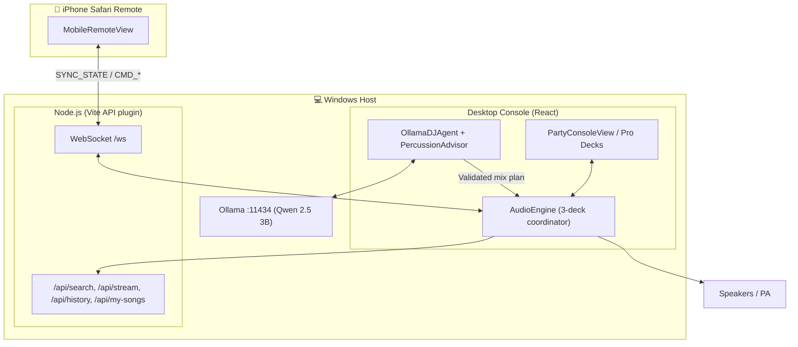
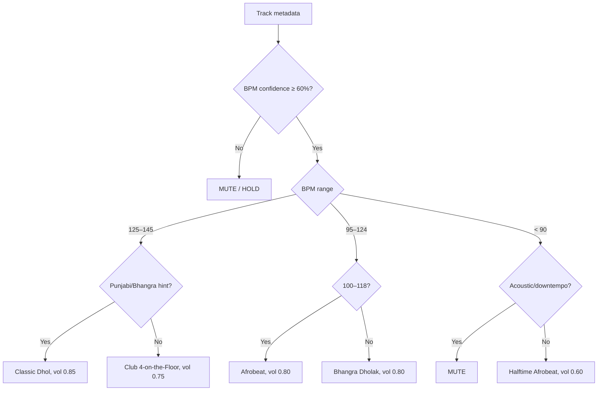

# AI DJ — Architecture & Engine Specification

This is the single technical reference for how AI DJ is built: system topology, the audio engine, BPM detection, the continuous percussion deck, transitions, auto-curation, viral-hook detection, the UI, and the mobile WebSocket protocol.

For requirements see [`context.md`](context.md). For musical behaviour rules see [`DJ_KNOWLEDGE_AND_MIXING_RULES.md`](DJ_KNOWLEDGE_AND_MIXING_RULES.md). For hardware, network setup and licenses see [`SETUP_AND_OPERATIONS.md`](SETUP_AND_OPERATIONS.md).

---

## 1. Core Invariants

1. **Audio Thread Invariant:** Real-time audio (Deck A, Deck B, Deck P) must never stutter or be blocked by AI inference, downloads, UI rendering, or analysis.
2. **Host Authority Principle:** The Windows laptop is the sole source of truth. The iPhone is only a control surface. Audio never goes through the phone, and a sleeping or disconnected phone never stops the music.
3. **Anti-Clash Rule:** Live percussion is muted or held if beat confidence is below 60% or the track is an acoustic/slow ballad. Silence beats out-of-sync drums.
4. **LLM as planner, not processor:** The LLM emits structured plans that are validated with Zod. The audio engine executes them deterministically.

---

## 2. Technology Stack

| Layer | Technology |
| :--- | :--- |
| UI | React 19, TypeScript, Vite, Tailwind CSS v4 |
| Desktop shell | Browser via Vite dev server today; Electron packaging planned |
| Audio engine | Web Audio API (native nodes, `AudioParam` automation) |
| Analysis | In-browser TypeScript DSP (`BpmDetector`, `HighlightDetector`); Python/Librosa MIR is a future option |
| Local AI | Ollama + Qwen 2.5 3B (CPU mode), Zod schema validation, heuristic fallback |
| Backend | Vite plugin (`server/apiPlugin.ts`): REST + `ws` WebSocket server |
| Acquisition | `yt-search` (metadata), `@distube/ytdl-core` (audio stream) |
| Storage | Local files + JSON (`data/play_history.json`, `my_songs.txt`) + in-memory state. SQLite only if needed later (see [storage policy](SETUP_AND_OPERATIONS.md#5-storage-policy)) |

---

## 3. System Topology



**Request flow:** mobile request → validated command → track acquisition → decode + analysis → ready queue → transition planner → audio engine → speakers. Deck P keeps running through the whole flow.

---

## 4. Audio Engine & Three-Deck Topology

- **Deck A**: outgoing/master track. **Deck B**: incoming track, tempo-matched and phase-aligned.
- **Deck P**: continuous percussion loop on its own timeline. Switching, fading or seeking A/B never restarts it.

```
  Deck A Source          Deck B Source          Deck P Source (looping)
       │                      │                      │
  Low shelf 250 Hz       Low shelf 250 Hz       Highpass 50 Hz (Q 0.707)
  Peak mid 1 kHz (Q1)    Peak mid 1 kHz (Q1)    Presence peak 3 kHz +2.5 dB
  High shelf 3.5 kHz     High shelf 3.5 kHz     Percussion gain + ducking
  Deck A gain (xfade L)  Deck B gain (xfade R)       │
       └──────────────┬───────┴──────────────────────┘
                 Master mix bus → Limiter (knee −1 dBFS) → Destination
```

**3-band isolator EQ:** each band ranges from −40 dB to +6 dB. At −40 dB the band is effectively silenced (a full kill).

---

## 5. BPM & Downbeat Detection (`src/audio/BpmDetector.ts`)

```
PCM → IIR lowpass (160 Hz) → energy envelope → adaptive onset threshold
    → inter-onset intervals → BPM histogram → plausibility window → BPM + confidence
```

1. **Low-pass** to isolate kicks and dhol strikes: $y[n] = (1-\alpha)y[n-1] + \alpha x[n]$, $\alpha = \frac{2\pi f_c/f_s}{1 + 2\pi f_c/f_s}$.
2. **Energy** over 1024-sample windows (~23 ms). An onset is a local maximum where $E[k] > M[k] + 1.35\,\sigma[k]$, with mean and standard deviation taken over the last ~1 s (43 blocks).
3. **IOI histogram:** $\text{BPM} = 60/\Delta t$, kept only within 70–180 BPM and binned per integer BPM, with energy weighting.
4. **Confidence:** (mass of the peak bin plus adjacent bins) ÷ total histogram mass, giving a value in [0, 1].
5. **First downbeat** (`firstDownbeatTime`) is also emitted. It is used for percussion phase-locking.

---

## 6. Continuous Percussion (Deck P)

### 6.1 Procedural synthesis (`src/audio/SynthesizedSamples.ts`)
All percussion is synthesised mathematically. No commercial samples are used, so there is no copyright risk.

- **Dagga (bass head):** $f(t) = 48 + 17e^{-14t}$ Hz, amplitude $e^{-7t}$.
- **Thapi (treble head):** $f(t) = 850e^{-28t}$ Hz with $e^{-24t}$ decay, plus a bandpass noise burst (Q 4 at 850 Hz).
- **Hi-hats and claps:** white-noise bursts with exponential decay.

| Pattern ID | Name | Base BPM | Character |
| :--- | :--- | :--- | :--- |
| `punjabi_dhol` | Punjabi Dhol Live | 128 | Dhol chaap with heavy dagga and sharp thapi crack |
| `bhangra_groove` | Bhangra Dholak & Chimta | 130 | Wedding/club bhangra bounce with metallic chimta accents |
| `electronic_drums` | Club 4-on-the-Floor | 126 | 909 kick, 808 clap on 2 & 4, rolling 16th hats |
| `afrobeat` | Afrobeat Shakers & Congas | 120 | Syncopated congas, shakers, polyrhythmic groove |

Deck P loops play at `currentBpm / defaultBpm`, so the drums follow the on-air deck's real speed.

### 6.2 "Cherry on top" sync: three pillars
1. **Downbeat phase-lock:** `syncPhaseToTime()` aligns the loop to the song's first downbeat:
   $\text{Phase} = (\max(0, t - t_{\text{downbeat}}) \bmod \text{LoopDur}) \times \text{Rate}$.
   Matching BPM alone is not enough. Without phase alignment, the dhol hits flam against the song's kick.
2. **Frequency separation:** the 50 Hz highpass leaves room for the song's 808 and kick. The 3 kHz presence boost lets the thapi and chimta transients sit on top of the mix.
3. **Arrangement ducking:** percussion sits at **35%** during verses ($t < T_{\text{hook}} - 6\text{s}$) and opens to **100%** at the viral hook.

### 6.3 PercussionAdvisor (`src/ai/PercussionAdvisor.ts`)
Runs every 500 ms and decides on/off, style and target tempo. It always locks Deck P's tempo to the track's tempo.



---

## 7. Phrase-Aware Transitions

```
Bars:          1          2          3          4          5
Deck A gain:  1.00 ────> 0.70 ────> 0.30 ────> 0.00
Deck A bass:  0 dB ────> 0 dB ────> −40 dB ──> −40 dB
Deck B gain:  0.00 ────> 0.30 ────> 0.70 ────> 1.00
Deck B bass: −40 dB ───> −40 dB ──> 0 dB ────> 0 dB
Deck P:       PLAYING ─────────────────────────────────> PLAYING (uninterrupted)
```

1. **Analysis first:** every track's BPM, confidence, downbeat and hook are detected once, when it is preloaded or acquired. This happens whether or not auto-drums are on.
2. **Pitch-safe tempo matching:** deck tempo is changed through `playbackRate`, which also shifts pitch because there is no time-stretch. So:
   - The incoming rate is $\text{BPM}_A / (\text{BPM}_B \times m)$, with $m \in \{0.5, 1, 2\}$ chosen to give the smallest change.
   - The engine beatmatches only when both BPM confidences are ≥ 0.6 and the shift is ≤ 6% (about 1 semitone).
   - Otherwise the incoming song plays at its natural pitch, and the overlap is cut to a 4 s crossfade so unsynced beats don't flam.
   - The rate is set before the incoming deck starts.
3. **Pitch return:** after the mix, an engine-set rate glides back to 1.0 at 0.4% per second. A 6% shift returns in about 15 s. Manual pitch fader settings are never touched.
4. **Bass swap:** the outgoing low band ramps to −24 dB over the first half. The incoming low band ramps from −24 dB to 0 dB over the second half.
5. **Audio-clock scheduling:** the crossfade (equal-power curve) and the EQ ramps are scheduled as `AudioParam` automation. Mixes therefore finish correctly even when the browser tab is hidden. Moving the crossfader by hand cancels an automatic mix.
6. **Outro auto-trigger:** when ≤ 14 s remain and a queued track is **ready**, the transition fires. If nothing is ready, the current song keeps playing. **Next** does nothing except show a status message, and a song is never swapped in mid-mix.
7. **Drums follow the on-air deck:** when the mix ends, Deck P re-syncs its pattern, tempo and phase to the new song.

### 7.1 LLM mixing plans (`src/ai/OllamaDJAgent.ts`, `src/ai/schema.ts`)
A natural-language request plus the current BPM, bar and key metadata go to Qwen 2.5 3B. The raw JSON reply is validated with Zod. If validation fails, the engine falls back to a standard 8-bar crossfade, so a bad reply never interrupts audio.

```json
{
  "action": "execute_transition",
  "incoming_track_id": "track_punjabi_02",
  "transition_type": "bass_swap_phrase_aligned",
  "start_bar_offset": 4,
  "transition_length_bars": 16,
  "tempo_ramp": { "start_bpm": 126.0, "end_bpm": 128.0, "curve": "exponential" },
  "percussion": { "active": true, "pattern_id": "punjabi_dhol_groove_128", "ducking_during_vocals": true, "volume_percent": 85 },
  "eq_automation": { "outgoing_low_kill_bar": 8, "incoming_low_active_bar": 8 }
}
```

---

## 8. 5-Song Auto-Curation & Acquisition

### 8.1 Auto-curation
- **Invariant:** keep at least 5 compatible tracks queued and pre-decoded.
- Search `yt-search` using the current track's artist, genre and mood.
- *(Planned)* Filter candidates by tempo compatibility. Today, songs whose tempos are too far apart get a short natural-pitch crossfade instead (§7).
- Acquire candidates in the background and add them to the queue with `isAiRecommended: true`.

### 8.2 Acquisition pipeline
```
CMD_SEARCH_AND_MIX → yt-search metadata → status 'searching'
  → /api/stream (ytdl-core, audio-only, highestaudio, 4 MB buffer) → status 'downloading'
  → ArrayBuffer → decodeAudioData() → BpmDetector + HighlightDetector
  → status 'ready' → phrase transition
```
- Decoding happens entirely in memory, so no temp files are left on disk.
- Audio-only Opus is about 3.8 MB versus about 45 MB for 1080p video. A track is usually ready in under 2.5 s.
- Queue statuses: `queued | downloading | decoding | ready | failed`.

---

## 9. Viral Hook Detection (`src/audio/HighlightDetector.ts`)

The goal is to skip 30–60 s low-energy intros and drop into the part listeners replay most.

**Tier 1, YouTube "Most Replayed" heatmap:** segments have the form `{ startMillis, durationMillis, intensityScoreNormalized }`.
- Ignore 0:00–0:15, because replays from the start bias the data.
- Search within $15\text{s} \le t \le \text{Duration} - 15\text{s}$ and accept the peak if its intensity is at least 0.35.

| Track | $T_{\text{hook}}$ | Intensity |
| :--- | :--- | :--- |
| Despacito — Luis Fonsi | 1:24 | 1.00 |
| Counting Stars — OneRepublic | 1:16 | 0.58 |
| Never Gonna Give You Up — Rick Astley | 0:42 | 0.27 (below 0.35 → Tier 2 fallback) |
| 295 — Sidhu Moose Wala | 0:52 | 0.94 |
| Lover — Diljit Dosanjh | 0:48 | 0.91 |

**Tier 2, local RMS energy** (for local files or when no heatmap is available):
- Compute RMS over 1 s windows, then smooth with a 7-window moving average ($K = 3$) to reject one-off spikes.
- Take the maximum within 18–75% of the track length.

**Pre-roll cue:** start the track 16 beats before the hook, snapped to the 16-beat grid.
$T_{\text{raw}} = T_{\text{hook}} - 16 \cdot \frac{60}{\text{BPM}}$. If $T_{\text{raw}} \le 5$ s, cue at 0:00. Otherwise $T_{\text{cue}} = \lfloor \lfloor T_{\text{raw}}/\Delta t_{\text{beat}} \rfloor / 16 \rfloor \cdot 16 \cdot \Delta t_{\text{beat}}$.

**UI:**
- The waveform shows an amber `🔥 HOOK` marker at $T_{\text{hook}}$ and an emerald marker at $T_{\text{cue}}$.
- Each deck has a `🔥 HOOK` button.
- The `Hook Cue: ACTIVE/OFF` toggle auto-cues loaded tracks to $T_{\text{cue}}$.
- `🔥 PLAY BEST PART` is available on the desktop and mobile.

---

## 10. User Interface

### 10.1 Party Master Console (`PartyConsoleView.tsx`, default view)
- A rotating vinyl disc with album art.
- A hook badge with a "Drop to Hook" button.
- Track title and artist, a scrubber, and the current BPM.
- Prev, −10s, Play, +10s and Next buttons.
- A "Play World's Favorite Part" button and the Hook Cue toggle.
- A **Live Rhythm Enhancer** card for style choice (Dhol, Bhangra, Club, Afrobeat) and vibe presets (Subtle, Party Bounce, Festival Peak).
- An **Up Next** queue with song/URL search, the most-played "Start With This" bangers, and the `my_songs.txt` loader and editor.
- A header switch for **🎛️ Pro Decks**: `DeckView` (waveforms, pitch, EQ kills), `MixerSection` (crossfader) and `PercussionBar`.

### 10.2 iPhone Remote (`src/remote/MobileRemoteView.tsx`)
- Large touch targets (at least 48×48 pt) on a dark high-contrast theme: amber = dhol, cyan = Deck A, violet = Deck B.
- No `<audio>` tags, so iOS never takes audio focus or reroutes audio.
- Reconnects automatically after the phone sleeps and receives the latest state immediately.

---

## 11. WebSocket Protocol (`/ws`)

### 11.1 Host → Mobile: `SYNC_STATE` (10 Hz)
```typescript
interface HostSyncState {
  type: 'SYNC_STATE';
  activeDeck: 'A' | 'B';
  currentTrack: { id: string; title: string; artist: string; duration: number; bpm: number; bpmConfidence?: number; thumbnail?: string } | null;
  isPlaying: boolean;
  currentTime: number;
  duration: number;
  bpm: number;
  crossfader: number;               // -1.0 (A) … +1.0 (B)
  percussion: { isPlaying: boolean; activePatternId: string; volume: number; intensity: number; currentBpm: number; isMuted: boolean };
  queue: Array<{ id: string; title: string; artist: string; duration: number; status: 'queued' | 'downloading' | 'decoding' | 'ready' | 'failed'; isAiRecommended?: boolean }>;
  isTransitioning: boolean;
  transitionProgress: number;       // 0.0 … 1.0
  percussionDecisionReason: string;
  autoCurationEnabled: boolean;
  autoPercussionEnabled: boolean;
  autoCueViralHook: boolean;
}
```

### 11.2 Mobile → Host commands
| Command | Payload | Behaviour |
| :--- | :--- | :--- |
| `CMD_PLAY` / `CMD_PAUSE` / `CMD_STOP` | `{}` | Resume or pause the active deck, or stop everything. |
| `CMD_SEEK` | `{ deltaSeconds }` | Relative seek (±10 s). |
| `CMD_SEEK_TO` | `{ targetSeconds }` | Absolute seek. |
| `CMD_PREV` / `CMD_NEXT` | `{}` | Restart or go to the previous track; mix into the next **ready** track. |
| `CMD_PERCUSSION_TOGGLE` / `CMD_PERCUSSION_MUTE` | `{}` | Turn Deck P on or off, or mute it. |
| `CMD_PERCUSSION_PATTERN` | `{ patternId }` | Switch the rhythm pattern. |
| `CMD_PERCUSSION_VOLUME` | `{ volume }` | Percussion gain (0 … 1). |
| `CMD_AUTO_PERCUSSION` | `{}` | Toggle automatic drum decisions. |
| `CMD_TOGGLE_AUTOCURATION` | `{}` | Toggle internet auto-curation. |
| `CMD_MIX_NOW` | `{ query }` | Acquire a track and mix it in immediately. |
| `CMD_ADD_QUEUE` | `{ query }` | Add a track to the front of the queue. |
| `CMD_JUMP_TO_HOOK` | `{ deckId? }` | Jump to the viral hook. |
| `CMD_TOGGLE_AUTO_CUE_HOOK` | `{}` | Toggle hook auto-cue. |
| `CMD_LOAD_MY_SONGS` | `{}` | Load `my_songs.txt`. |
| `CMD_PLAY_STARTER_SONG` | `{ songId }` | Start the set with a most-played song. |
